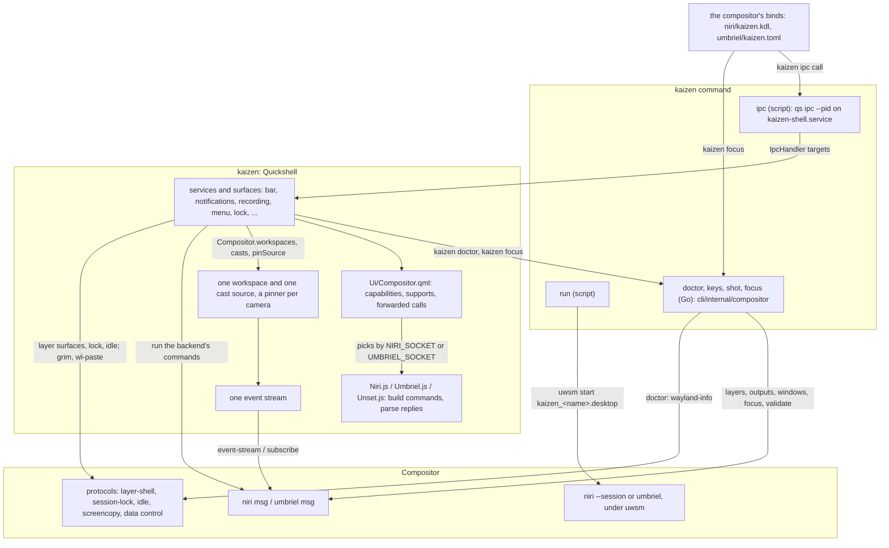
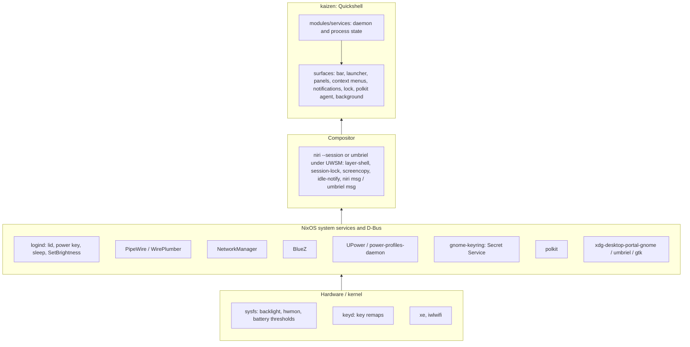

# kaizen

`kaizen` is a [Quickshell](https://quickshell.org) shell for
[niri](https://niri-wm.github.io/niri/) or
[umbriel](https://github.com/noctalia-dev/umbriel): a minimal, keyboard-first
desktop that an agent can drive and verify from a terminal.

- [`features.md`](docs/features.md): individual features and their rationale.
- [`plugins.md`](docs/plugins.md): optional shell extensions and how to write
  one.
- [`style.md`](docs/style.md): palette, color roles, shapes, panels, and status
  marks.
- [`interaction.md`](docs/interaction.md): keybindings, menus, the bar, panels,
  the tray, and applications.
- [`development.md`](docs/development.md): workflow, validation, and deployment.
- [`issues.md`](docs/issues.md): upstream bugs that kaizen and the shared
  toolchain work around, with their patches and current status.

## Intent

- **NixOS is the base.** System services (systemd, D-Bus, logind, PipeWire,
  NetworkManager, BlueZ, UPower, PAM, polkit, and XDG portals) run unmodified.
  The shell reads and controls their state instead of maintaining its own copy.
- **Build only what is used.** Add a panel only when a subsystem lacks a
  keyboard-first interface. Leave infrequent tasks to purpose-built apps
  (`bluetui`, `nm-connection-editor`, `pwvucontrol`, `wdisplays`).
- **Keyboard-first everywhere.** Pointer-only controls are bugs.
- **Scriptable from a terminal.** Every action is reachable through `kaizen`
  (`kaizen --json` lists commands; `kaizen ipc` drives the shell), `niri msg`
  or `umbriel msg`, and `systemctl --user`.
- **Host-agnostic naming.** Use `kaizen` in systemd units, PAM configs, layer
  namespaces, and state files. Never hardcode hostnames in desktop
  configuration.

## Compositors

niri is the stable compositor; umbriel is on trial. Every kaizen host installs
both, and you choose one at login: `kaizen run` starts niri, and
`kaizen run -c umbriel` starts umbriel (see [Session](#session)).



Arrows point from caller or reader to target. Both the shell and the Go CLI
detect the active compositor from its socket environment variable. Umbriel's
screencast source reads PipeWire nodes directly instead of the event stream.

- **Socket selection:** Each compositor exports an IPC socket variable
  (`NIRI_SOCKET` or `UMBRIEL_SOCKET`). The shell and the `kaizen` CLI pick the
  compositor whose variable is set, talking to it exclusively through a
  per-compositor backend in
  [`Ui/compositors/`](stow/.config/quickshell/kaizen/Ui/compositors/) (see
  [Surfaces](#surfaces)) and
  [`cli/internal/compositor/`](cli/internal/compositor/). If neither variable is
  set, or if both are set (for instance, in a nested session or with a stale
  variable from an earlier session), the `Unset` backend fails every call
  instead of falling back to niri. The shell still runs and can lock the screen,
  and `kaizen doctor` flags the problem.
- **Configs and portals:** Each compositor has its own kaizen config (see
  [Where it lives](#where-it-lives)) and portal setup (see [Session](#session)).
  Configs are kept in sync by hand, except titled keybinds, which `qml-test`
  verifies for parity (`tst_Compositors.qml`).
- **Filling compositor gaps:** When a compositor lacks a feature, its backend
  uses an external tool. For example, umbriel uses `grim` for screenshots and
  reads PipeWire's node list to detect screen sharing.
- **Required vs. optional capabilities:**
  - *Required Wayland protocols:* `layer-shell`, `ext-session-lock`,
    `screencopy`, `ext-idle-notify`, `virtual-keyboard`, and `data-control`.
    `kaizen doctor` checks the `protocol` lines in
    [`requires`](stow/.config/quickshell/kaizen/requires) and warns if optional
    gamma control (nightlight) or virtual pointer (`wlrctl`) protocols are
    missing.
  - *Required backend operations:* listing outputs and the focused output;
    focusing an output, workspace, or app; closing a window; DPMS control;
    keybinds; and keyboard layouts.
  - *Optional features:* auto-DnD on screencasts, window screenshots, color
    picker, recording camera overlay, and border colors. If a backend omits any
    of these, the shell hides the corresponding launcher rows and panel
    controls.

Adding a new compositor `<name>` requires the following pieces, matching niri
and umbriel:

1. **Session:** Add `kaizen_<name>.desktop` to
   [`wayland-sessions/`](stow/.local/share/wayland-sessions/) with
   `DesktopNames=<name>;kaizen;`. Add its `wayland-session@` and
   `wayland-session-xdg-autostart@` targets to `WantedBy=` in
   [`kaizen-session.target`](stow/.config/systemd/user/kaizen-session.target)
   and `kaizen-session-xdg-autostart.target`, with matching `.wants/` symlinks.
   Accept `<name>` in [`run`](stow/.local/libexec/kaizen/run)'s `-c` flag.
2. **Nix:** Add the compositor package (from a flake input if nixpkgs lags) and
   its portal—configured to use gnome-keyring's Secret portal—to
   [`nix/default.nix`](nix/default.nix). Add the binary to the default devshell
   in `flake.nix` so `compositor-test` can run.
3. **Requirements:** List the compositor's `cmd`, its portal's `data` line, and
   any gap-filling tools in
   [`requires`](stow/.config/quickshell/kaizen/requires).
4. **QML backend:** Implement `Ui/compositors/<Name>.js` conforming to
   `Contract.js`, along with its event stream, workspace source, and optional
   components, and register it in `Ui/Compositor.qml`. Add it to
   `tst_Compositors.qml` (contract and bind parity) and add its own `tst_*.qml`
   tests.
5. **Go backend:** Implement `Compositor` in
   [`cli/internal/compositor/`](cli/internal/compositor/), register it in the
   `compositors` map, and add tests.
6. **Configs:** Add `<name>/kaizen.*` with the same titled binds as niri, plus
   per-host `config.*`, `outputs.*`, and `host.*` files in
   `stow/host/<host>/.config/<name>/` (see [Where it lives](#where-it-lives)).
   Add config validation to
   [`config_test.sh`](stow/.config/quickshell/kaizen/tests/config_test.sh)
   (`compositor-test`).
7. **Docs:** Document `<name>` alongside niri and umbriel in
   [`development.md`](docs/development.md) (Versions, `kaizen keys`, and SSH
   socket setup).

## Layers



Each layer calls downward only.

## Where it lives

Nix manages anything that needs a system module, root privileges, or the Nix
store: the two lower layers plus packages (including the `kaizen` CLI), applied
on rebuild. Stow manages files edited in place that take effect on save:
compositor configs, systemd user units and scripts, shell and plugin QML,
plugin enablement configs, and notification rules.

| Part | Path | Reaches |
| --- | --- | --- |
| Session: niri and umbriel under UWSM, portals, PAM, system services, and packages used by the shell, binds, scripts, and units | [`kaizen/nix/`](nix/default.nix) | every kaizen host |
| The `kaizen` CLI (Go), built by [`package.nix`](nix/package.nix) | [`kaizen/cli/`](cli/) | every kaizen host |
| Shell compositor configs, session env vars, units, scripts, QML, and core notification rules | [`kaizen/stow/`](stow/) | every kaizen host |
| Generic or reusable plugin QML | [`kaizen/stow/.config/quickshell/kaizen/plugins/<name>/`](stow/.config/quickshell/kaizen/plugins/) | every kaizen host |
| Host-specific plugin QML | `stow/host/<host>/.config/kaizen/plugins/<name>/` | that host |
| Plugin enablement and config | `stow/host/<host>/.config/kaizen/plugins/<name>.jsonc`, or a host's private submodule `stow/` | that host |
| Generic or reusable plugin unit | [`kaizen/stow/.config/systemd/user/`](stow/.config/systemd/user/) | every host enabling the plugin |
| Host-specific plugin unit | `stow/host/<host>/.config/systemd/user/` | that host |
| Plugin daemon and packages | `kaizen/nix/plugins/<name>/`, `nix/hosts/<host>/kaizen-plugins/<name>/` | hosts importing it |
| ThinkPad hardware config read by the shell (battery thresholds, keyd, micmute LED); not part of kaizen | [`nix/shared/system/thinkpad.nix`](../nix/shared/system/thinkpad.nix) | ThinkPad hosts |
| Host hardware, sleep policy, compositor configs, output layout, and host-only apps | `nix/hosts/<host>/`, `stow/host/<host>/` | that host |

- **Core vs. plugins:** Core is what kaizen needs to work as designed and runs
  on every kaizen host. Plugins are optional: the shell always runs without
  them, regardless of how many hosts enable them.
- **Host enablement:** Importing [`kaizen/nix/`](nix/default.nix) makes a host a
  kaizen host by writing `/etc/kaizen`. [`stow.sh`](../stow.sh) runs
  `kaizen link` only when `/etc/kaizen` exists and unstows
  [`kaizen/stow/`](stow/) elsewhere. As a result, [`kaizen/stow/`](stow/) is
  either linked completely or not at all; a plugin's QML there loads only when
  enabled by `~/.config/kaizen/plugins/<name>.jsonc`.
- **Requirement checks at build time:** Each host lists the Stow trees it links
  into `$HOME` in `kaizen.configTrees` ([`requires.nix`](nix/requires.nix)). The
  Nix build uses this list to verify the `requires` file of every enabled
  plugin.
- **`kaizen link [DIR]`:** Stows `kaizen/stow/` from `DIR` (default
  `~/.dotfiles`) into `$HOME`, cleans up broken symlinks pointing into
  `DIR/kaizen/`, and reloads the systemd user manager if running. Because it
  depends on no stowed files, it works on a fresh install; Home Manager
  activation has it on `PATH`.
- **Systemd user units:** Enable a unit by placing a symlink in the relevant
  `.wants/` directory, then reload via `kaizen link`. Units invoke packaged
  binaries (including `kaizen`) through `/usr/bin/env` so they resolve from the
  session `PATH`.
- **Two config directories:** The shell runs as `quickshell -c kaizen`.
  `~/.config/quickshell/kaizen/` contains only files from
  [`kaizen/stow/`](stow/), while `~/.config/kaizen/` holds host-specific config
  (enabled plugins and their JSONC files, notification rules, and host-only
  plugin QML). Defining the same plugin name in both directories is an error—one
  does not shadow the other. To run a worktree's shell tree instead, use
  `kaizen dev` (see [`development.md`](docs/development.md) › Working from a
  worktree).
- **Shell compositor files:** kaizen ships one file per compositor:
  [`niri/kaizen.kdl`](stow/.config/niri/kaizen.kdl) and
  [`umbriel/kaizen.toml`](stow/.config/umbriel/kaizen.toml). Each defines what
  the shell requires: session environment variables (niri only; umbriel exports
  its own), keybinds calling `kaizen`, rules for shell surfaces and windows, and
  border colors written by the shell. Keep both files in sync by hand: any bind
  or rule added to one belongs in the other. Bind labels use
  `hotkey-overlay-title` in niri and trailing comments in umbriel (which has no
  label key).
- **User compositor files:** `~/.config/niri/config.kdl` and
  `~/.config/umbriel/config.toml` belong to the user (input, layout, window
  management, and user keybinds). Each host keeps parallel files under
  `stow/host/<host>/.config/<compositor>/`, maintained in sync by hand:
  - `config.*` (shared from `renoir` and linked by `wily`) includes the host's
    `outputs.*`, kaizen's file, and finally `host.*` (if present) so host binds
    win.
  - Because niri evaluates includes in place,
    [`config.kdl`](../stow/host/renoir/.config/niri/config.kdl) holds the shared
    settings around its includes.
  - Because umbriel evaluates includes before a file's own keys,
    [`config.toml`](../stow/host/renoir/.config/umbriel/config.toml) contains
    only includes, while shared settings live in `common.toml` (also linked by
    `wily`).
- **The `kaizen` CLI:** `kaizen` is the only kaizen binary on `PATH`, built from
  [`kaizen/cli/`](cli/) into the system profile. Running `kaizen <sub>` executes
  the Go subcommand in [`kaizen/cli/internal/command/`](cli/internal/command/),
  or falls back to `~/.local/libexec/kaizen/<sub>` with the binary's own
  directory prepended to `PATH`. Units, compositor binds, and QML always invoke
  `kaizen`, never a script path directly. `kaizen --json` lists commands as
  `{ name, usage, summary }`, and `kaizen --version` prints the built commit
  (`unknown` when built by Nix). A local `~/.local/bin/kaizen` overrides the
  system binary in interactive terminals (see
  [`development.md`](docs/development.md) › Building kaizen). Commands and
  scripts detect the compositor via its socket variable, just like the shell.
- **Internal subcommands:** `kaizen internal <sub>` runs
  `~/.local/libexec/kaizen/internal/<sub>` for commands used only by units or
  builds, not humans or agents. `kaizen internal` (with optional `--json`) lists
  them.
- **Emoji data:** The shell reads `kaizen/emoji.json` from XDG data directories,
  generated at Nix build time by
  [`kaizen internal emoji`](stow/.local/libexec/kaizen/internal/emoji).
- **Applications:** Apps do not belong in kaizen; see
  [`nix/README.md`](../nix/README.md) for where they go.
- **Path shorthand in these docs:** QML paths (`modules/…`, `Ui/…`) are relative
  to
  [`kaizen/stow/.config/quickshell/kaizen/`](stow/.config/quickshell/kaizen/),
  and `niri/…` paths are relative to [`kaizen/stow/.config/`](stow/.config/).

## Off NixOS

On non-NixOS distros, the OS must supply everything provided by
[the core Nix module](nix/default.nix) and any enabled plugin's Nix module.
Session variables still come from Stow
([`uwsm/env-kaizen`](stow/.config/uwsm/env-kaizen)) on any distro.

`kaizen doctor` checks and reports:

- Any missing program, D-Bus service, file, session variable, font, Qt plugin,
  or Wayland protocol listed in
  [`requires`](stow/.config/quickshell/kaizen/requires) or an enabled plugin's
  `plugins/<name>/requires`.
- A niri config that does not include `kaizen.kdl`, or an umbriel config that
  does not include `kaizen.toml`.
- An XDG portal that does not answer color-scheme queries.
- A `gsr-kms-server` binary missing `cap_sys_admin+ep` (needed so monitor
  capture skips the portal dialog).

`kaizen doctor` cannot check:

- `gnome-keyring` acting as the Secret Service, or `ghostty` being listed first
  in `xdg-terminals.list`.
- PipeWire with ALSA and PulseAudio compatibility layers, `rtkit`, and polkit
  with `pkexec`.
- The contents of `/etc/pam.d/kaizen-lock` (only that the file exists). It must
  authenticate the user's password (`auth include login` on NixOS) for the lock
  screen and curtain.
- Fonts in [`fonts.nix`](nix/fonts.nix) that the shell does not explicitly name.
- Quickshell's [overlay patches](nix/default.nix). Without them:
  - Every Quickshell start logs a host-portal warning (reported by
    `kaizen doctor`).
  - Electron tray icons log a property warning (reported by `kaizen doctor`).
  - A lock ended by the compositor leaves the lock service stuck as locked.
- `investigate` having `go` and `gopls` on its `PATH` (for the incident
  investigator plugin).
- The `kaizen` CLI: install it to `~/.local/bin/kaizen` with
  [`kaizen/cli/build.sh`](cli/build.sh) using the host's Go toolchain, or build
  it via `nix build ~/.dotfiles#kaizen`.
- Emoji data: generate `~/.local/share/kaizen/emoji.json` with
  [`kaizen internal emoji`](stow/.local/libexec/kaizen/internal/emoji).

## Services to surfaces

Each service wraps one subsystem and feeds the surfaces below. The IPC column
names `<target>` in `kaizen ipc call <target> ...`, which targets the process
run by `kaizen-shell.service`.

| Service | Subsystem | Bar | Panel / launcher | IPC |
| --- | --- | --- | --- | --- |
| audio | [PipeWire] via [Quickshell] | volume button | Settings › Audio | `audio` |
| battery | [UPower], [sysfs power_supply] thresholds, [power-profiles-daemon] | battery button | Settings › Power | `battery` |
| bluetooth | [BlueZ] via [Quickshell] | button | Settings › Bluetooth | `bluetooth` |
| brightness | [sysfs backlight] via [logind] SetBrightness | – | XF86 keys | `brightness` |
| clipboard | [wl-clipboard] watcher (in memory) | – | Trigger › Clipboard | `clipboard` |
| doctor | `kaizen-*` unit state and journal, compositor config, plugin dirs, and `requires` files via `kaizen doctor` | doctor indicator | Settings › Doctor | `doctor` |
| firmware | [fwupd] via `fwupdmgr` | firmware indicator | Settings › Firmware | `firmware` |
| idle | [ext-idle-notify], lock service | idle indicator | Settings › Session | `idle` |
| keyboard | compositor XKB layouts | layout indicator | Settings › Keyboard layout | `keyboard` |
| media | [MPRIS] | now-playing widget | Settings › Media | `media` |
| mirror | [wl-mirror] in a transient `kaizen-mirror-<target>` user unit per mirror | mirror indicator | Settings › Display › Mirror | `mirror` |
| network | [NetworkManager], `ip -j` | button | Settings › Network | `network` |
| nightlight | [wl-gammarelay-rs] over D-Bus, weather location for solar position | – | Settings › Display › Nightlight | `nightlight` |
| recording | [gpu-screen-recorder], [grim], [satty], [PipeWire] | recording indicator | Trigger › Record, Pause, Stop, Screenshot (region, desktop, window) | `recording` |
| system | [hwmon], `/proc` load | alert indicator | Settings › Display | `system`, `display` |
| timezone | [timedated] via `timedatectl`, `zdump` for DST rules | time button | Settings › Time | `timezone` |
| weather | [met.no locationforecast], [SMHI warnings] for Swedish locations | button | Settings › Weather | `weather` |
| dnd | shell-wide mode that features read to suppress interruptions; turned on by recording and compositor screencasts | – | Settings › Do not disturb (DnD) | `dnd` |
| notifications | [Desktop Notifications] server, held back under DnD | bell button | Settings › Notifications | `notifications` |
| lock | [ext-session-lock] + [PAM] `kaizen-lock` | – | Settings › Session | `lock` |
| curtain | [wlr-layer-shell] + [PAM] | – | Settings › Session | `curtain` |
| polkit agent | [polkit] | – | dialog on request | – |
| tray | [StatusNotifierItem] | tray | Tray | `tray` |
| background | wallpaper files, theme state | – | Settings › Display | `wallpaper`, `theme` |
| menu | launcher | menu button | `Mod+Space` | `menu` |
| plugins | `plugins/<name>/Plugin.qml` for each `~/.config/kaizen/plugins/<name>.jsonc` whose `plugin.json` matches `plugin-api` | date button (if claimed); indicators | Plugins › each plugin | `shell` (reload) |

[PipeWire]: https://pipewire.org
[Quickshell]: https://quickshell.org/docs/types/
[UPower]: https://upower.freedesktop.org
[sysfs power_supply]: https://www.kernel.org/doc/Documentation/ABI/testing/sysfs-class-power
[power-profiles-daemon]: https://gitlab.freedesktop.org/upower/power-profiles-daemon
[BlueZ]: https://github.com/bluez/bluez
[sysfs backlight]: https://www.kernel.org/doc/Documentation/ABI/stable/sysfs-class-backlight
[logind]: https://www.freedesktop.org/software/systemd/man/latest/org.freedesktop.login1.html
[wl-clipboard]: https://github.com/bugaevc/wl-clipboard
[fwupd]: https://fwupd.org
[ext-idle-notify]: https://wayland.app/protocols/ext-idle-notify-v1
[MPRIS]: https://specifications.freedesktop.org/mpris-spec/latest/
[NetworkManager]: https://networkmanager.dev
[wl-mirror]: https://github.com/Ferdi265/wl-mirror
[wl-gammarelay-rs]: https://github.com/MaxVerevkin/wl-gammarelay-rs
[gpu-screen-recorder]: https://git.dec05eba.com/gpu-screen-recorder/about/
[grim]: https://sr.ht/~emersion/grim/
[satty]: https://github.com/gabm/Satty
[hwmon]: https://docs.kernel.org/hwmon/sysfs-interface.html
[met.no locationforecast]: https://api.met.no/weatherapi/locationforecast/2.0/documentation
[SMHI warnings]: https://opendata.smhi.se/warnings
[Desktop Notifications]: https://specifications.freedesktop.org/notification-spec/latest/
[ext-session-lock]: https://wayland.app/protocols/ext-session-lock-v1
[PAM]: https://github.com/linux-pam/linux-pam
[wlr-layer-shell]: https://wayland.app/protocols/wlr-layer-shell-unstable-v1
[polkit]: https://www.freedesktop.org/software/polkit/docs/latest/
[StatusNotifierItem]: https://www.freedesktop.org/wiki/Specifications/StatusNotifierItem/
[timedated]: https://www.freedesktop.org/software/systemd/man/latest/org.freedesktop.timedate1.html

## Surfaces

```text
Launcher (modules/menu)            palette; keyboard entry point, drills down levels
  ├─ Apps, Keybindings, Emoji     providers
  ├─ Trigger                      screenshots, recording, clipboard, window actions
  ├─ Settings                     per bar button: its panel, then its actions; Session
  ├─ Tray                         tray menus, cascaded per level
  └─ Plugins                      one node per plugin
Panel (Ui/Panel)                   centered card; h/l step focus
Context menu (Ui/ContextMenu)      hangs from the bar button that opened it
Bar (modules/bar)                  one PanelWindow per output
Notifications, Lock, Polkit, Background, Curtain   own layer surfaces
```

- **Exclusive focus:** The launcher, panels, and context menus take exclusive
  keyboard focus and dismiss one another via `shell.claimPanel`. Choose the
  surface based on how it is triggered.
- **Context menu:** Opens on its anchor button's output and sizes to fit its
  rows, with submenus cascading beside their parent row. Each card is a
  `Ui/MenuCard`; typing a query in a card closes any open submenus to its right.
  When opened without a specific output (such as from the launcher's Tray
  level), it queries the compositor for the focused output. Context menus
  display tray item menus or a bar button's launcher subtree on right-click.
- **Launcher:** Renders the same `Ui/MenuCard` centered inside a `Ui/Panel`,
  navigating one level at a time. `menu popup <id>` and `menu level <id>` open
  it directly at a given level.
- **In-app palette and menus:** Applications render a palette over their window
  content (`Ui/MenuOverlay`) using actions declared by the focused item and its
  ancestors (`menuScope()`). Right-clicking an item or clicking a chip opens a
  cascading context menu anchored to the pointer or chip (`popup()`).
- **IPC and docs:** Every surface can be opened over IPC, and compositor binds
  call `kaizen ipc call ...`. See [`interaction.md`](docs/interaction.md) for
  input rules (including bar button kinds) and [`plugins.md`](docs/plugins.md)
  for how plugins add launcher items, panels, IPC targets, and bar indicators.
- **Compositor facade:**
  [`Ui/Compositor.qml`](stow/.config/quickshell/kaizen/Ui/Compositor.qml) is the
  shell's sole interface to the compositor. It picks one backend at startup
  based on the socket variable (falling back to `Unset.js`).
  [`Ui/compositors/`](stow/.config/quickshell/kaizen/Ui/compositors/) owns
  compositor commands, reply parsing, and the workspace, screencast, and
  camera-pinning sources. `Compositor` runs a single event stream (`events`)
  that feeds shared `workspaces` and `casts` sources for the bar and
  notifications, while recording loads the camera pinner from `pinSource`. Late
  subscribers read the stream's cached state (so niri's stream retains full
  state). Keep scheduling and shared state above the backend layer. Nightlight
  is compositor-independent and lives in its own service.
- **Capability flags:** When compositor differences affect a surface or service,
  `Compositor` exposes a capability flag instead of a compositor name:
  `releaseExclusiveFocus` (panel/context menu focus), `replacesDeadLock` (lock
  recovery after a crash), `opensOnFocusedOutput` (mirror),
  `floatsInWorkingArea` (recording camera overlay), and `placesBackdrop`
  (backdrop wallpaper). `Niri.js` and `Umbriel.js` set each flag.
- **Backend contract:** `Ui/compositors/Contract.js` defines every required
  property and function that `Compositor` forwards, plus optional feature
  groups—a backend must implement all functions in an optional group or none of
  them. `tst_Compositors.qml` validates every backend (including `Unset.js`)
  against this contract. Any new required function on `Compositor` must be added
  to all backends. Surfaces check `Compositor.supports.<feature>`, and hidden
  launcher rows set `hidden`. Each backend's `readBinds` translates its
  compositor syntax into chords formatted for `Chords.js` (`Mod+Shift+Key` with
  XKB key names).

## Session

```text
TTY login ─ kaizen run ─ uwsm start kaizen_niri.desktop ─ niri --session
          (kaizen run -c umbriel ─ uwsm start kaizen_umbriel.desktop ─ umbriel)
  └─ wayland-session@kaizen_<compositor>.desktop.target
       └─ kaizen-session.target
            ├─ kaizen-shell.service      Restart=on-failure
            └─ kaizen-sleep-lock.service logind delay inhibitor
lid close / power key ─ logind ─ sleep-lock locks shell ─ waits for secure ─ suspend
```

`kaizen run` launches the desktop entry
[`kaizen_niri.desktop`](stow/.local/share/wayland-sessions/kaizen_niri.desktop)
(niri), while `kaizen run -c umbriel` launches
[`kaizen_umbriel.desktop`](stow/.local/share/wayland-sessions/kaizen_umbriel.desktop)
(umbriel). Because uwsm names its units after the desktop entry ID, starting a
plain niri session (`uwsm start niri`) does not start any kaizen units.

During environment setup, the entry's `DesktopNames` sets
`XDG_CURRENT_DESKTOP=niri:kaizen` (or `umbriel:kaizen`), which selects the
portals and causes uwsm to source
[`uwsm/env-kaizen`](stow/.config/uwsm/env-kaizen) and export its variables to
the systemd user manager (changes take effect on the next login). Once started,
`niri --session` sets `XDG_CURRENT_DESKTOP=niri` (and umbriel sets `umbriel`),
so portals and `OnlyShowIn=niri` autostart entries see the plain compositor
name.

Each desktop entry's `wayland-session@<entry>.target` and
`wayland-session-xdg-autostart@<entry>.target` want `kaizen-session.target` and
`kaizen-session-xdg-autostart.target`. Kaizen's units bind to those generic
targets instead of naming a specific desktop entry. Do not order kaizen units
after `graphical-session.target` (that creates a dependency cycle); order them
after `wayland-session-waitenv.service`, which finishes once the compositor
exports `WAYLAND_DISPLAY`.

Lid close uses logind defaults: suspend on lid close (after `kaizen-sleep-lock`
locks the session), or ignore when docked. While docked with the lid closed,
niri disables `eDP-1`; umbriel leaves it on because no `[events]` lid commands
are configured.

- **Tray readiness before autostart:** XDG autostart apps wait for
  `kaizen-tray-ready.service` (which waits until the shell's
  `StatusNotifierWatcher` is on D-Bus) because Electron apps check for the
  watcher only once at startup and never retry. Never order
  `kaizen-shell.service` or anything before `graphical-session.target` on the
  tray: the shell registers the watcher only after loading its config, which
  waits on `xdg-desktop-portal`, and the portal starts after
  `graphical-session.target`.
- **Portals and session mode:** On niri, screen sharing from apps goes through
  `xdg-desktop-portal-gnome`, which requires Mutter D-Bus services that niri
  provides only under `niri --session`. Session mode also provides
  `org.freedesktop.ScreenSaver` idle inhibitors and the accessibility bus, and
  intercepts the power key from logind unless `disable-power-key-handling` is
  set. On umbriel, portals use `xdg-desktop-portal-umbriel`, falling back to GTK
  (`umbriel-portals.conf`).
- **gnome-keyring first use:** If the `login` keyring is created after D-Bus
  starts, `gnome-keyring` may advertise it without exporting the collection. To
  recover, restart and unlock the keyring daemon, then retry account setup. Do
  not delete keyring files.
- **Chromium and Electron secret storage:** Chromium and Electron pick their
  secret store from `XDG_CURRENT_DESKTOP`. Because they recognize neither `niri`
  nor `umbriel`, they fall back to `basic_text` (losing logins or encrypting
  with a hardcoded key). Wrap each app with `pkgs.withGnomeLibsecret`
  (`nix/shared/overlays/`), which passes `--password-store=gnome-libsecret`
  (`chromium` passes the flag directly). Do not add `GNOME` to
  `XDG_CURRENT_DESKTOP`—autostart entries like `nm-applet` and `print-applet`
  set `NotShowIn=GNOME`. Once an app encrypts secrets with the keyring, removing
  the flag locks it out of those secrets.

## Where the shell writes

| Kind | Path | Lifetime |
| --- | --- | --- |
| Regenerable cache | `~/.cache/kaizen-shell/` | until deleted |
| Persistent state | `~/.local/state/kaizen-shell/` | across reboots |
| Lock and socket state | `$XDG_RUNTIME_DIR/kaizen-<name>` | until logout |

- **Three roots only:** Never write into `~/.config/quickshell/kaizen/` or
  `~/.config/kaizen/`—those are Stow trees.
- **Flat files:** Store single values or small JSON files directly in the root.
  The unit's `StateDirectory=` creates the state root automatically.
- **Subdirectories:** Use a subdirectory for many or unbounded entries (such as
  `kaizen-shell/wallpaper-thumbs/`), and direct files for single items (such as
  `kaizen-shell/weather-complete-<lat>_<lon>.json`). When migrating from a
  single file to per-input files, clean up the old file first.
- **Self-pruning caches:** Nothing sweeps `~/.cache` on these hosts, so every
  cache producer must prune its own entries: update an entry's mtime on use
  (cache hits and HTTP 304 responses count) and delete entries older than 30
  days in the same pass. If a producer cannot age entries this way, document
  what bounds its size in a comment.
- **Plugins:** Plugins follow the same roots and rules (see
  [`plugins.md`](docs/plugins.md) › Writing one).

## Out of scope

- **Bluetooth pairing and network connection editing:** handled by `bluetui` and
  `nm-connection-editor`.
- **Output layout:** maintained by hand in
  `stow/host/<host>/.config/niri/outputs.kdl` and its twin
  `umbriel/outputs.toml`, keyed by monitor rather than port. `wdisplays`
  (Settings › Display › Arrange outputs) lets you preview layouts live and copy
  each monitor's name, scale, and position into those files, but saves nothing.
- **Compositor-side XKB toggling:** the shell owns keyboard layout state; a
  compositor-side toggle would desynchronize it.
- **Clipboard persistence:** clipboard history is in memory only. Offers with
  `x-kde-passwordManagerHint` are skipped (Proton Pass and 1Password set it; a
  password manager that omits it will be recorded).
- **Portal-based screen recording:** `gpu-screen-recorder` talks to PipeWire
  directly.
- **Fingerprint unlock:** would block password typing in the single PAM stack.

## Adding something

Before adding a feature, ask:

1. Does a system service already own this state? If so, read it—do not duplicate
   it.
2. Does a purpose-built app already handle it well? If so, launch that app
   instead.
3. Can it be operated completely by keyboard? If not, redesign it.

Once it passes those checks, put each piece in its place:

- **Daemon/process state:**
  [`modules/services/`](stow/.config/quickshell/kaizen/modules/services/), wired
  in [`shell.qml`](stow/.config/quickshell/kaizen/shell.qml).
- **Panel view:**
  [`modules/panels/`](stow/.config/quickshell/kaizen/modules/panels/), wired in
  [`shell.qml`](stow/.config/quickshell/kaizen/shell.qml). Protocol-driven
  surfaces whose state has no other consumer (lock, notifications, polkit) keep
  service and view together under `modules/<name>/`.
- **Packages, system services, and PAM:** [`nix/default.nix`](nix/default.nix)
  (declare every package kaizen uses here, even if another scope also installs
  it). Apps do not belong in kaizen; see [`nix/README.md`](../nix/README.md).
- **User units and scripts:** [`systemd/user/`](stow/.config/systemd/user/) and
  [`.local/libexec/kaizen/`](stow/.local/libexec/kaizen/).
- **Compositor integration:**
  [`Ui/compositors/`](stow/.config/quickshell/kaizen/Ui/compositors/) and both
  [`niri/kaizen.kdl`](stow/.config/niri/kaizen.kdl) and
  [`umbriel/kaizen.toml`](stow/.config/umbriel/kaizen.toml).
- **IPC:** expose an IPC target for every new action.
- **Optional extensions:** build them as [plugins](docs/plugins.md).
