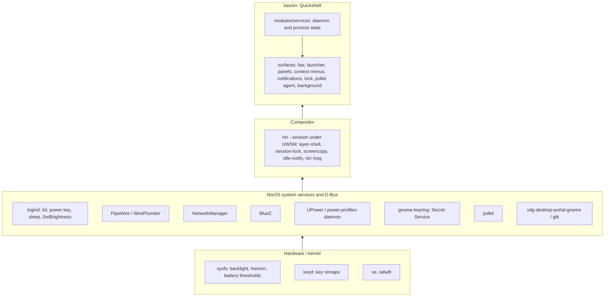

# kaizen

`kaizen` is a [Quickshell](https://quickshell.org) shell for
[niri](https://niri-wm.github.io/niri/): a minimal, keyboard-first desktop
that an agent can drive and verify from a terminal.

- [`features.md`](docs/features.md): description of individual features.
- [`plugins.md`](docs/plugins.md): optional shell extensions and how to write
  one.
- [`style.md`](docs/style.md): palette, colour roles, shapes, status marks.
- [`interaction.md`](docs/interaction.md): keys, menus, the bar, panels, tray
  and applications.
- [`development.md`](docs/development.md): working on kaizen, validation and
  deployment.

## Intent

- NixOS is the base. systemd, D-Bus, logind, PipeWire, NetworkManager, BlueZ,
  UPower, PAM, polkit and the portals do their jobs untouched; the shell reads
  and drives their state, never owns a copy of it.
- Build only what is used. A panel exists only where a subsystem has no
  keyboard-first face; infrequent tasks go to a purpose-built application
  (bluetui, nm-connection-editor).
- Keyboard-first everywhere. Pointer-only controls are bugs.
- Every action is reachable from a terminal: the `kaizen` commands
  (`kaizen --json` lists them; `kaizen ipc` drives the shell), `niri msg` and
  `systemctl --user`.
- Host-agnostic naming: "kaizen" in units, PAM, layer namespaces and state
  files. No hostname in the desktop's configuration.

## Layers



Each layer calls downward only.

## Where it lives

Nix holds what needs a system module, root or the store: the two lower layers
and the packages, the `kaizen` command among them, applied on rebuild. Stow
holds files edited in place, live on
save: the shell's niri config, the units and scripts, the shell's and plugins'
QML, which plugins run, and the notification rules.

| Part | Path | Reaches |
| --- | --- | --- |
| Session: niri under UWSM, portals, PAM, the services the shell reads, the packages the shell, its binds, scripts and units use | [`kaizen/nix/`](nix/default.nix) | every kaizen host |
| The `kaizen` command, in Go, built by [`package.nix`](nix/package.nix) | [`kaizen/cli/`](cli/) | every kaizen host |
| The shell's niri config, session variables, units and scripts, the shell's QML, the core's notification rules | [`kaizen/stow/`](stow/) | every kaizen host |
| Plugin QML: generic or reusable | [`kaizen/stow/.config/quickshell/kaizen/plugins/<name>/`](stow/.config/quickshell/kaizen/plugins/) | every kaizen host |
| Plugin QML: specific to one host | `stow/host/<host>/.config/kaizen/plugins/<name>/` | that host |
| Which plugins run, with their config | `stow/host/<host>/.config/kaizen/plugins/<name>.jsonc`, or in a private submodule's `stow/` such as wily's `einride` | that host |
| A plugin's unit: generic or reusable | [`kaizen/stow/.config/systemd/user/`](stow/.config/systemd/user/) | every kaizen host that enables the plugin |
| A plugin's unit: specific to one host | `stow/host/<host>/.config/systemd/user/` | that host |
| A plugin's daemon and packages | `kaizen/nix/plugins/<name>/`, `nix/hosts/<host>/kaizen-plugins/<name>/` | the hosts importing it |
| ThinkPad hardware the shell reads (thresholds, keyd, micmute LED); not kaizen | [`nix/shared/system/thinkpad.nix`](../nix/shared/system/thinkpad.nix) | ThinkPad hosts |
| Hardware, sleep policy, the niri config and output layout, host-only programs | `nix/hosts/<host>/`, `stow/host/<host>/` | that host |

- Core is what kaizen needs to work as designed; every kaizen host runs it. A
  plugin is optional: the shell runs without it, however many hosts enable it.
- Importing
  [`kaizen/nix/`](nix/default.nix)
  makes a host a kaizen host: it writes `/etc/kaizen`, and
  [`stow.sh`](../stow.sh) runs `kaizen link` only where that exists, and
  unstows [`kaizen/stow/`](stow/) elsewhere. So
  [`kaizen/stow/`](stow/) reaches every kaizen host or none, and a
  plugin's QML there loads only where a `~/.config/kaizen/plugins/<name>.jsonc`
  enables it.
- `kaizen link [DIR]` links `kaizen/stow/` of the checkout DIR (default
  `~/.dotfiles`) into `$HOME` with Stow, after removing broken links into its
  `kaizen/`, and reloads the user manager when one runs. It needs no stowed
  file, so it works on a first install; Home Manager's activation has it on
  PATH.
- A `.wants/` link beside a unit enables it, and `kaizen link` reloads the user
  manager. A unit runs a packaged program, `kaizen` included, through
  `/usr/bin/env`, from the session PATH.
- The shell is the Quickshell config `kaizen`, run as `quickshell -c kaizen`:
  `~/.config/quickshell/kaizen/` holds only files from
  [`kaizen/stow/`](stow/). `~/.config/kaizen/` holds only a host's
  configuration: which plugins run and their config, notification rules, and
  its plugins' QML. A plugin name in both is an error: neither shadows the
  other. `kaizen dev` runs a worktree's shell tree instead:
  [`development.md`](docs/development.md) › Working from a worktree.
- kaizen ships one niri file,
  [`niri/kaizen.kdl`](stow/.config/niri/kaizen.kdl): what the shell needs,
  namely the session's environment, binds calling `kaizen`, rules for the
  shell's surfaces and windows, and the border colours the shell writes. The
  niri config, `~/.config/niri/config.kdl`, is the user's: input, layout,
  window management and its binds. It includes `kaizen.kdl`. Here it is
  [`config.kdl`](../stow/host/renoir/.config/niri/config.kdl) in renoir's
  host package, which wily links, with each host's `outputs.kdl`, `apps.kdl`
  and `host.kdl` (`stow/host/<host>/.config/niri/`) included around
  `kaizen.kdl`, the last two after it, so their binds win.
- `kaizen` is the only kaizen command on PATH, built from
  [`kaizen/cli/`](cli/) into the system profile. `kaizen <sub>` runs its Go
  command `<sub>`
  ([`kaizen/cli/internal/command/`](cli/internal/command/)), else
  `~/.local/libexec/kaizen/<sub>` with the binary's own directory first on its
  PATH. Units, niri binds and QML call it, never a script's path.
  `kaizen --json` lists the commands as `{ name, usage, summary }`, and
  `kaizen --version` prints the commit it was built from (`unknown` from Nix). A
  `~/.local/bin/kaizen` overrides it: [`development.md`](docs/development.md) ›
  Building kaizen.
- `kaizen internal <sub>` runs `~/.local/libexec/kaizen/internal/<sub>`: what
  the system runs, as a unit or a build, and a person or an agent has no use
  for. `kaizen internal` lists them, and `--json` works there too.
- The shell reads its emoji data from `kaizen/emoji.json` in the XDG data dirs,
  which Nix builds with
  [`kaizen internal emoji`](stow/.local/libexec/kaizen/internal/emoji).
- Apps are not kaizen's: [`nix/README.md`](../nix/README.md) says where they
  go.
- QML paths here (`modules/…`, `Ui/…`) are under
  [`kaizen/stow/.config/quickshell/kaizen/`](stow/.config/quickshell/kaizen/);
  `niri/…` is under [`kaizen/stow/.config/`](stow/.config/).

## Off NixOS

The distro supplies what
[the core's Nix module](nix/default.nix) and each
enabled plugin's do on NixOS; the session variables come from Stow
([`uwsm/env-kaizen`](stow/.config/uwsm/env-kaizen)) on either.
`kaizen doctor` reports each program, D-Bus
service, file, session variable, font and Qt plugin missing from
[`requires`](stow/.config/quickshell/kaizen/requires) and from
each enabled plugin's `plugins/<name>/requires`, a portal that does not
answer the colour scheme, and a `gsr-kms-server` without `cap_sys_admin+ep`,
which lets monitor capture skip the portal dialog. It cannot check:

- gnome-keyring as Secret Service, and ghostty first in
  `xdg-terminals.list`.
- PipeWire with its ALSA and PulseAudio layers, rtkit, and polkit with
  `pkexec`.
- What `/etc/pam.d/kaizen-lock` holds, only that it exists: a stack that
  authenticates the user's password (`auth include login` on NixOS), for the
  lock and the curtain.
- The fonts in [`fonts.nix`](nix/fonts.nix) the shell does not name, and its
  fontconfig rules.
- Quickshell with the [overlay's patch](nix/default.nix) (without it, every
  Quickshell start logs a host portal warning `kaizen doctor` reports), and
  `investigate` with go and gopls on its PATH for the incident investigator.
- The `kaizen` command: [`kaizen/cli/build.sh`](cli/build.sh) installs it
  as `~/.local/bin/kaizen` with the host's Go, or
  `nix build ~/.dotfiles#kaizen` builds it.
- The emoji data: run
  [`kaizen internal emoji`](stow/.local/libexec/kaizen/internal/emoji)
  into `~/.local/share/kaizen/emoji.json`.

## Services to surfaces

Every service wraps one subsystem and feeds the surfaces below. IPC target is
`kaizen ipc call <target> ...`, which reaches the process `kaizen-shell.service`
runs.

| Service | Subsystem | Bar | Panel / launcher | IPC |
| --- | --- | --- | --- | --- |
| audio (panel only) | [PipeWire] via [Quickshell] | volume button | Settings › Audio | `audio` |
| battery | [UPower], [sysfs power_supply] thresholds, [power-profiles-daemon] | battery button | Settings › Power | `battery` |
| bluetooth | [BlueZ] via [Quickshell] | button | Settings › Bluetooth | `bluetooth` |
| brightness | [sysfs backlight] via [logind] SetBrightness | – | XF86 keys | `brightness` |
| clipboard | [wl-clipboard] watcher, in memory | – | Trigger › Clipboard | `clipboard` |
| doctor | the `kaizen-*` units' state and journal, niri's config, the plugin dirs and the `requires` files, via `kaizen doctor` | doctor indicator | Settings › Doctor | `doctor` |
| firmware | [fwupd] via `fwupdmgr` | firmware indicator | Settings › Firmware | `firmware` |
| idle | [ext-idle-notify], lock service | idle indicator | Settings › Session | `idle` |
| keyboard | [niri] XKB layouts | layout indicator | Settings › Keyboard layout | `keyboard` |
| media | [MPRIS] | now-playing widget | Settings › Media | `media` |
| mirror | [wl-mirror] in a transient `kaizen-mirror-<target>` user unit per mirror | mirror indicator | Settings › Display › Mirror | `mirror` |
| network | [NetworkManager], `ip -j` | button | Settings › Network | `network` |
| nightlight | [wl-gammarelay-rs] over D-Bus, the weather location for the solar position | – | Settings › Display › Nightlight | `nightlight` |
| recording | [gpu-screen-recorder], [grim], [satty], [PipeWire] | recording indicator | Trigger › Record, Pause, Stop, Screenshot (region, desktop, window) | `recording` |
| system | [hwmon], `/proc` load | alert indicator | Settings › Display | `system`, `display` |
| timezone | [timedated] via `timedatectl`, `zdump` for the DST rules | time button | Settings › Clock | `timezone` |
| weather | [met.no locationforecast] | button | Settings › Weather | `weather` |
| notifications | [Desktop Notifications] server, [niri] casts for DnD | bell button | Settings › Notifications | `notifications` |
| lock | [ext-session-lock] + [PAM] `kaizen-lock` | – | Settings › Session | `lock` |
| curtain | [wlr-layer-shell] + [PAM] | – | Settings › Session | `curtain` |
| polkit agent | [polkit] | – | dialog on request | – |
| tray | [StatusNotifierItem] | tray | Tray | `tray` |
| background | wallpaper files, theme state | – | Settings › Display | `wallpaper`, `theme` |
| menu | launcher | menu button | `Mod+Space` | `menu` |
| plugins | `plugins/<name>/Plugin.qml` for each `~/.config/kaizen/plugins/<name>.jsonc`, when its `plugin.json` matches `plugin-api` | date button, when taken over; indicators | Plugins › each plugin | `shell` (reload) |

[PipeWire]: https://pipewire.org
[Quickshell]: https://quickshell.org/docs/types/
[UPower]: https://upower.freedesktop.org
[sysfs power_supply]: https://www.kernel.org/doc/Documentation/ABI/testing/sysfs-class-power
[power-profiles-daemon]: https://gitlab.freedesktop.org/upower/power-profiles-daemon
[BlueZ]: https://github.com/bluez/bluez
[sysfs backlight]: https://www.kernel.org/doc/Documentation/ABI/stable/sysfs-class-backlight
[logind]: https://www.freedesktop.org/software/systemd/man/latest/org.freedesktop.login1.html
[wl-clipboard]: https://github.com/bugaevc/wl-clipboard
[fwupd]: https://fwupd.org
[ext-idle-notify]: https://wayland.app/protocols/ext-idle-notify-v1
[niri]: https://github.com/YaLTeR/niri/wiki
[MPRIS]: https://specifications.freedesktop.org/mpris-spec/latest/
[NetworkManager]: https://networkmanager.dev
[wl-mirror]: https://github.com/Ferdi265/wl-mirror
[wl-gammarelay-rs]: https://github.com/MaxVerevkin/wl-gammarelay-rs
[gpu-screen-recorder]: https://git.dec05eba.com/gpu-screen-recorder/about/
[grim]: https://sr.ht/~emersion/grim/
[satty]: https://github.com/gabm/Satty
[hwmon]: https://docs.kernel.org/hwmon/sysfs-interface.html
[met.no locationforecast]: https://api.met.no/weatherapi/locationforecast/2.0/documentation
[Desktop Notifications]: https://specifications.freedesktop.org/notification-spec/latest/
[ext-session-lock]: https://wayland.app/protocols/ext-session-lock-v1
[PAM]: https://github.com/linux-pam/linux-pam
[wlr-layer-shell]: https://wayland.app/protocols/wlr-layer-shell-unstable-v1
[polkit]: https://www.freedesktop.org/software/polkit/docs/latest/
[StatusNotifierItem]: https://www.freedesktop.org/wiki/Specifications/StatusNotifierItem/
[timedated]: https://www.freedesktop.org/software/systemd/man/latest/org.freedesktop.timedate1.html

## Surfaces

```text
Launcher (modules/menu)            palette; keyboard entry point, drills down levels
  ├─ Apps, Keybindings, Emoji     providers
  ├─ Trigger                      screenshots, recording, clipboard, window actions
  ├─ Settings                     per bar button: its panel, then its actions; Session
  ├─ Tray                         tray menus, cascaded per level
  └─ Plugins                      one node per plugin
Panel (Ui/Panel)                   centered card; h/l step focus
Context menu (Ui/ContextMenu)      hangs from the bar button that opened it
Bar (modules/bar)                  one PanelWindow per output
Notifications, Lock, Polkit, Background, Curtain   own layer surfaces
```

- Launcher, panel and context menu hold exclusive keyboard focus and close
  each other through `shell.claimPanel`. Pick by what opens the surface.
- A context menu opens on its button's output, sized to its rows; submenus
  cascade beside their row. Each card draws with `Ui/MenuCard`, and a query on
  one closes the cards right of it. Opened without an output (the launcher's
  Tray level), it resolves the focused output from the compositor. It shows a
  tray item's menu, or a launcher level on a bar button's right-click.
- The launcher draws the same card centred in a `Ui/Panel`, a level at a time.
  `menu popup <id>` and `menu level <id>` open it at that level.
- An application's palette draws it over the window's content
  (`Ui/MenuOverlay`), from the actions the focused item and its parents
  declare (`menuScope()`). A right-click there, or a click on a chip, hangs a
  cascading context menu from the pointer or the chip (`popup()`).
- Every surface opens over IPC; niri binds are `spawn kaizen ipc call ...`.
- How each surface takes input, the bar buttons' kinds included:
  [`interaction.md`](docs/interaction.md).
- Plugins add launcher items, panels, IPC targets and bar indicators:
  [`plugins.md`](docs/plugins.md).
- [`Ui/Compositor.qml`](stow/.config/quickshell/kaizen/Ui/Compositor.qml)
  is the only path to niri;
  [`Ui/compositors/`](stow/.config/quickshell/kaizen/Ui/compositors/)
  owns niri commands, response parsing, and the workspace and screencast
  sources, which the bar and notifications load through its URLs. Keep
  scheduling and shared state above it. Nightlight is not compositor-specific
  and lives in its service.
- Where the compositor's behaviour shapes a surface or service, `Compositor`
  exposes a capability for it to read, not a compositor name to check:
  `releaseExclusiveFocus` (panel and context menu focus), `replacesDeadLock`
  (lock restore after a crash), `opensOnFocusedOutput` (mirror),
  `floatsInWorkingArea` (recording's camera). `Niri.js` sets each.

## Session

```
TTY login ─ kaizen run ─ uwsm start kaizen.desktop ─ niri --session
  └─ wayland-session@kaizen.desktop.target
       ├─ kaizen-shell.service      Restart=on-failure
       └─ kaizen-sleep-lock.service logind delay inhibitor
lid close / power key ─ logind ─ sleep-lock locks shell ─ waits for secure ─ suspend
```

The session is the entry
[`kaizen.desktop`](stow/.local/share/wayland-sessions/kaizen.desktop), which
runs niri. uwsm names its units after the entry ID, so another session on
niri (`uwsm start niri`) starts none of kaizen's. Its `DesktopNames` give
uwsm `XDG_CURRENT_DESKTOP=niri:kaizen` while it prepares the environment. For
the name `kaizen`, uwsm sources [`uwsm/env-kaizen`](stow/.config/uwsm/env-kaizen)
and exports its session variables to the user manager; a change applies from
the next login. `niri --session` then sets and exports
`XDG_CURRENT_DESKTOP=niri`, so portals and `OnlyShowIn=niri` autostart entries
see plain niri.

Units bind to `wayland-session@kaizen.desktop.target`; ordering after
`graphical-session.target` is a cycle. `wayland-session-waitenv.service`
closes niri's readiness-before-`WAYLAND_DISPLAY` race.

Lid close uses logind defaults: suspend (the sleep-lock unit locks first), or
nothing when docked. Niri turns off `eDP-1` while docked with the lid closed.

- XDG autostart apps start only once the shell's StatusNotifierWatcher is on
  the bus (`kaizen-tray-ready.service`), because Electron apps look for it once
  and never retry. Never gate `kaizen-shell.service` or anything before
  `graphical-session.target` on the tray: the shell registers the watcher once
  its config loads, which waits for `xdg-desktop-portal`, and the portal is
  ordered after `graphical-session.target`.
- Screen sharing from other apps goes through `xdg-desktop-portal-gnome`,
  which needs the Mutter D-Bus services that niri serves only as
  `niri --session`. Session mode also serves `org.freedesktop.ScreenSaver`
  idle inhibitors and the a11y bus, and takes the power key from logind unless
  `disable-power-key-handling` is set.
- On first use, gnome-keyring can advertise `login` without exporting the
  collection when keyring creation follows D-Bus startup. Recover by
  restarting the keyring daemon and unlocking it, then retry account setup.
  Do not delete keyring files.
- Chromium and Electron pick their secret store from `XDG_CURRENT_DESKTOP`. They
  do not recognise `niri` and fall back to `basic_text`, so logins and secrets
  do not persist or are stored under a hardcoded key. Wrap each such app with
  `pkgs.withGnomeLibsecret` (`nix/shared/overlays/`), which adds
  `--password-store=gnome-libsecret`; `chromium` passes the flag directly. Do
  not add `GNOME` to `XDG_CURRENT_DESKTOP`: autostart entries such as
  `nm-applet` and `print-applet` use `NotShowIn=GNOME`. Once an app has
  encrypted secrets with the keyring, removing the flag locks it out of them.

## Where the shell writes

| Kind | Path | Lifetime |
| --- | --- | --- |
| Regenerable cache | `~/.cache/kaizen-shell/` | until deleted |
| State that must survive | `~/.local/state/kaizen-shell/` | across reboots |
| Lock and socket state | `$XDG_RUNTIME_DIR/kaizen-<name>` | until logout |

- These three roots only. `~/.config/quickshell/kaizen/` and `~/.config/kaizen/`
  are Stow's trees.
- Files are flat in the root, one value or small JSON document each. The
  unit's `StateDirectory=` creates the state root.
- Many or unbounded entries get a subdirectory
  (`kaizen-shell/wallpaper-thumbs/`); a single file is written directly
  (`kaizen-shell/weather-<lat>_<lon>.json`). Moving from one file to one per
  input needs a sweep first.
- Every cache producer prunes its own entries, since nothing prunes `~/.cache`
  on these hosts: touch an entry on use (a hit or a 304 counts) and delete
  entries older than 30 days in the same pass. A producer that cannot age
  entries this way says in a comment what bounds it.
- Plugins write under the same roots: [`plugins.md`](docs/plugins.md) › Writing
  one.

## Out of scope

- Bluetooth pairing, connection editing: bluetui, nm-connection-editor.
- Output layout: hand-kept in `stow/host/<host>/.config/niri/outputs.kdl`,
  keyed by monitor, not port.
- Compositor-side XKB toggling: the shell owns layout state, and a
  compositor-side toggle would desynchronize it.
- Clipboard persistence: memory only. Offers carrying
  `x-kde-passwordManagerHint` are skipped; Proton Pass and 1Password set it, a
  password manager that does not would be recorded.
- Portal-based recording: gpu-screen-recorder talks to PipeWire directly.
- Fingerprint unlock: would block typing in the single PAM stack.

## Adding something

1. Does a subsystem already do it? Read its state; do not duplicate it.
2. Does a purpose-built app do it acceptably? Launch that instead.
3. Can it be used with the keyboard only? If not, redesign.
4. Then: daemon/process state →
   [`modules/services/`](stow/.config/quickshell/kaizen/modules/services/),
   view →
   [`modules/panels/`](stow/.config/quickshell/kaizen/modules/panels/),
   both wired in
   [`shell.qml`](stow/.config/quickshell/kaizen/shell.qml); a
   protocol-driven surface with no other consumer of its state (lock,
   notifications, polkit) keeps both in `modules/<name>/`. Packages (even a
   package another scope also installs), system services and PAM →
   [`nix/default.nix`](nix/default.nix), units and
   scripts → [`systemd/user/`](stow/.config/systemd/user/) and
   [`.local/libexec/kaizen/`](stow/.local/libexec/kaizen/),
   compositor →
   [`Ui/compositors/`](stow/.config/quickshell/kaizen/Ui/compositors/)
   and [`niri/kaizen.kdl`](stow/.config/niri/kaizen.kdl), IPC
   target for every new action. An optional shell extension is a
   [plugin](docs/plugins.md). An app is not kaizen's to install:
   [`nix/README.md`](../nix/README.md) says where it goes.
