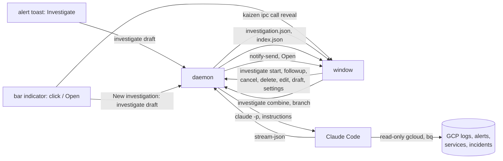

# Incident investigator

Adds an **Investigate** button to alert toasts. Clicking it drafts an
investigation, and a read-only Claude Code run searches GCP logs—using the
alert's trace ID or details from the notes (such as an alert URL, Logs Explorer
URL, or timestamp)—to report the likely root cause.

## Configuration

Importing this Nix module installs the daemon.
`~/.config/kaizen/plugins/incident-investigator.jsonc` enables the window and
configures the daemon, which reads it at startup (run
`systemctl --user restart kaizen-incident-investigator` to apply edits). Paths
may be absolute or start with `~/`.

```jsonc
{
  // Required. Claude Code profile (account and sessions) used for every run.
  "claudeConfigDir": "~/.claude-oncall",

  // Directories containing clones of service repositories so runs can read
  // code at the deployed commit. Leave empty to inspect logs and alerts only.
  "sourceDirs": ["~/code/github.com/my-org"],

  // Appended to Claude's system prompt on every turn, in order, after the
  // plugin's instructions.md (read in place).
  "instructionFiles": ["~/notes/my-org.md"],

  // Labels an investigation can carry, used for window filters and badges.
  "tags": [
    { "name": "prod", "color": "rose" },
    { "name": "dev", "color": "water" },
  ],

  // Extra regexes for extracting user and organization IDs from tool output,
  // in addition to `users/ID` and `organizations/ID` resource names.
  "entityPatterns": [
    {
      "kind": "user",
      "regex": "(?i)my[_-]?user[_-]?id\\W{1,8}([A-Za-z0-9_.-]+)",
    },
  ],

  // Regexes whose first capture group extracts GCP project IDs from alert text
  // that has no GCP alert URL.
  "projectPatterns": ["\\bproject_id=([a-z][a-z0-9-]{4,28}[a-z0-9])\\b"],
}
```

| Field | Default | Description |
| --- | --- | --- |
| `claudeConfigDir` | required | `CLAUDE_CONFIG_DIR` for every run |
| `sourceDirs` | `[]` | repository parent directories a run may read (see [Read-only runs](#read-only-runs)) |
| `instructionFiles` | `[]` | extra system prompt files appended after `instructions.md` |
| `tags` | `[]` | list of `{ name, color }` where `color` is a palette role |
| `entityPatterns` | `[]` | `{ kind, regex }` (`user` or `organization`), first capture group is the ID |
| `projectPatterns` | `[]` | regexes whose first capture group extracts a project from alerts without URLs |

An unknown field or a missing/invalid config file prevents the daemon from
starting; `kaizen doctor` reports the exact reason.

To attach the **Investigate** button to alert toasts, add a notification rule
(see [`features.md`](../../../docs/features.md) › Notifications › Rules) whose
action runs `investigate draft`. Pass `INVESTIGATE_TAG` (must match an entry in
`tags`; the daemon rejects anything else). If drafting fails, a critical toast
displays the error.

```jsonc
// ~/.config/kaizen/notification-rules.d/50-alerts.jsonc
[
  {
    "match": { "app": "^Slack$", "summary": " in #alerts$" },
    "border": "rose",
    "actions": [
      {
        "label": "Investigate",
        "command": ["investigate", "draft"],
        "env": { "INVESTIGATE_TAG": "prod" },
      },
    ],
  },
]
```



## Components

- **CLI and daemon (`investigate`):** One Go binary serves both roles.
  `investigate serve` runs the daemon, while client verbs (`draft`, `edit`,
  `start`, `followup`, `cancel`, `delete`, `tag`) send a single request over
  the socket and exit.
- **Daemon service:** A systemd user service listening on
  `$XDG_RUNTIME_DIR/kaizen-incident-investigator.sock`. It owns all
  investigations, state files, and `claude` subprocesses, so shell reloads
  never interrupt active runs.
- **Bar indicator:** Shown by the shell plugin, in `sky` while a turn runs.
  Left-click opens the window; right-click opens the plugin's launcher node,
  whose **New investigation** runs `investigate draft`.
- **Window:** A Quickshell `FloatingWindow` that watches the state files via
  `FileView` and invokes client verbs in response to user actions.
- **Claude Code turns:** Each turn runs as a `claude -p` subprocess of the
  daemon.
- **Model and effort:** The **Model** and **Effort** chips on drafts and beside
  the follow-up field (or **Model ›** and **Effort ›** in the palette) set the
  defaults for the next run (`settings`, stored in `settings.json`). Starting a
  run (**Run**, **Re-run**, etc.) saves those values onto the investigation
  (displayed in its header), and follow-ups and branches inherit them.
- **Property chips:** Each chip shows its current value, or its label in `off`
  when unset. Clicking a chip or pressing `Enter`/`Space` while focused opens
  its anchored submenu (matching the palette submenu of the same name). Drafts
  show **Tag**, **Projects**, **Model**, and **Effort** under the notes field;
  typing in **Projects ›** lets you add a new project.
- **Filtering and tagging:** **Filter** below the search box (or **Filter ›**
  in the palette) filters by tag (with counts from `settings.json`) or by
  project. Active filters appear as dismissible chips beside the button.
  Clicking **New** while a tag filter is active applies that tag to the new
  draft so it stays visible. The **Tag** chip in an investigation's header sets
  or clears its tag (`tag`) in any status.
- **Command palette (`Ctrl+K` / `?`):** Opens over the window scoped from
  nearest focus outward: the focused row's investigation (or selected set); the
  focused message (**Copy**, or **Copy selection** when text is highlighted,
  plus **Edit** and **Branch** on your own messages); the draft form,
  conversation, or multi-select view; the list (**Search list**, **Filter ›**,
  **Pick all listed**, **Go to ›**); and finally the window (**New**,
  **Clear**, **Model ›**, **Effort ›**). Shortcuts appear where active. See
  `Actions.js` for the per-scope row definitions. Pressing `Ctrl+Enter` inside
  a draft's trace ID or notes starts the run; plain `Enter` in the trace ID
  does not. In the follow-up field, `Enter` sends and `Shift+Enter` inserts a
  newline.
- **Row context menu:** Right-clicking a row opens a cascading context menu at
  the pointer containing the palette actions for that row (or for the selected
  set if the clicked row is selected), without altering the open investigation
  or current selection.
- **List keyboard navigation:** The list is a single Tab stop on its selected
  row. On a focused row: `j`/`k` (or `↑`/`↓`) move focus, and adding `Shift`
  selects a range; `Enter` opens the row and moves focus into its draft notes
  or follow-up field; `Space` toggles selection (while items are selected,
  `j`/`k` move focus only); `Backspace` prompts to delete selected rows (or the
  focused row); and `Esc` clears selection. Inside a text field, `Esc` clears
  selection first and then returns focus to the selected row. **Delete** and
  **Clear** always confirm inline (`y` or `Enter` confirms; `n`, `Esc`, or
  `Backspace` cancels).
- **Combining and branching:** Use `Shift`-click (range) or `Ctrl`-click
  (toggle) to select multiple investigations, then click **Combine**
  (`combine`) to draft a new investigation merging their alerts, reports, and
  entities, or **Delete** to remove them (running investigations are kept).
  Combined investigations show a merge icon in the list, highlight their source
  rows when selected, and list jump-to-source links under **Combined from**
  (clearing any filters hiding a source). Click the pencil icon (or press
  `Enter`) on one of your own messages to edit it in place, then **Branch**
  (`branch`) to replay from that point as a new investigation without modifying
  the original (or use **Branch** from the palette to replay unchanged).
  Branched sessions receive prior messages as plain text without tool calls.
  Every Claude message has a copy button.
- **Conversation navigation:** The conversation pane is a single Tab stop
  landing on the last focused message (or the newest); clicking also focuses a
  message. `j`/`k` (or `↑`/`↓`) move between messages, `Enter`/`Space` toggles
  folded command groups, `Ctrl+C` copies the text selection (or the entire
  message), and `Esc` returns to the list row. Right-clicking a message opens
  its context menu. Dragging selects text within a single paragraph or code
  block.
- **Entities:** The **entities** row displays user and organization IDs
  extracted directly from tool output (`users/ID`, `organizations/ID`, and
  `entityPatterns`). Because the daemon scans tool output itself, IDs never
  depend on the model and can be resolved to names outside it.

## Alert flow

1. Clicking **Investigate** on an alert toast runs `investigate draft` with
   `NOTIFICATION_APP`, `NOTIFICATION_SUMMARY`, `NOTIFICATION_BODY`, and
   `INVESTIGATE_TAG`.
2. The client sends `draft` over the socket. The daemon creates the draft,
   persists it, and returns its ID:
   - If the body contains a GCP alert or incident URL, that URL becomes the
     notes and its `project` query parameter sets the project.
   - If the alert came from Slack (which sends link labels without URLs), the
     full body becomes the notes, `projectPatterns` extract the projects, and
     the run locates the alert using the timestamp, resource, and policy named
     in the text.
3. The client runs `kaizen ipc call incident-investigator reveal <id>`, opening
   the window with the draft selected.
4. Fill in projects, trace ID, notes, and tag (`investigate edit`) and click
   **Start** (`investigate start`).
5. The daemon spawns `claude -p` with `instructions.md` (plus any
   `instructionFiles`) appended to the system prompt.
6. As Claude streams `stream-json` output, the daemon updates
   `<id>/investigation.json` and `index.json` while the window updates live.
   The report's `#` heading becomes the investigation's title.
7. When a turn finishes, the daemon sends a `notify-send` toast whose **Open**
   button calls `reveal`. Follow-ups run via `investigate followup`.

To test this flow without a real alert, send a fake toast matching your alert
rule:

```sh
notify-send -a Slack "[workspace] in #alerts-dev" \
  $'Fired for Cloud Run Revision with {project_id=my-project-dev}.\nView alert'
```

## Read-only runs

- **Sandbox flags:** Runs use `claude -p --restricted --tools "Bash,Read,Grep"`
  (adding `LSP` when `sourceDirs` is configured) with
  `--permission-mode dontAsk` and `--max-budget-usd 5` per turn. `--restricted`
  ignores user settings files and limits `Read` and `Grep` to the run directory
  and its own saved tool output.
- **Allowed commands:** Everything not explicitly listed below is denied:
  - Logging & Monitoring: `gcloud logging read`, `gcloud logging buckets list`,
    `gcloud alpha monitoring alerts describe|list`,
    `gcloud monitoring policies describe`
  - Cloud Run: `gcloud run services describe`,
    `gcloud run revisions list|describe`, `gcloud run jobs describe`
  - Databases: `gcloud sql instances|operations list|describe`,
    `gcloud spanner instances|operations list|describe`,
    `gcloud spanner databases list`
  - Service Health: `gcloud beta service-health events|artifacts list|describe`
    (requires `servicehealth.googleapis.com`; if disabled, the run notes it and
    continues)
  - BigQuery: `bq ls`, `bq show` (metadata and jobs only—`bq query`,
    `bq head`, and `--apilog` are denied)
  - Tools: `Read`, `Grep`
- **Log buckets:** Request searches skip `_Required`; runs query `_Required`
  only for system events and admin activity when a managed service fails.
- **Profiles:** Every run uses `claudeConfigDir`. Each investigation records
  its profile (shown in the window and used by **Terminal** to resume the
  session). Make sure `claudeConfigDir` is authorized to read any repositories
  in `sourceDirs`.
- **Source repositories (`sourceDirs`):**
  - Runs may read those directories and invoke read-only `git -C` subcommands
    (`log`, `show`, `diff`, `merge-base`, `rev-parse`, `cat-file`) to compare
    the deployed commit (from the Cloud Run image tag) against local clones.
    Each repository is allowlisted by exact path—wildcards before the
    subcommand would allow flags like `-c core.fsmonitor=CMD` that execute
    arbitrary commands.
  - Runs may also invoke `investigate checkout DIR/REPO COMMIT` for any clone
    directly under `sourceDirs`. This exports the commit with `git archive`
    into `<id>/src/REPO@SHA` (deleted alongside the investigation) without
    touching the clone's branch, working tree, or index. `GIT_OPTIONAL_LOCKS=0`
    prevents other git commands from taking `.git/index.lock`.
- **Go LSP (`gopls`):** The `LSP` tool runs the plugin's `gopls` with `go` and
  `gopls` prepended to `PATH`, kept offline via `GOPROXY=off` and
  `GOTOOLCHAIN=local`. Definitions in external modules open from `~/go/pkg/mod`
  at the version pinned by the checkout's `go.mod`; uncached modules are not
  downloaded, and only lookups into them fail.

## Where things live

State lives in `~/.local/state/kaizen-shell/plugins/incident-investigator/`
(the unit's `StateDirectory` / `$STATE_DIRECTORY`, accessed by the window via
`Ui.Paths.state`): `projects.json`, `settings.json`, `index.json`,
`<id>/investigation.json`, `<id>/transcript.jsonl`, and temporary checkouts in
`<id>/src/`. Because transcripts store log entries and code read during runs,
treat this directory with the same privacy as `sourceDirs`.

The window, `instructions.md`, and `claude-plugin/` live in
[`plugins/incident-investigator/`](../../../stow/.config/quickshell/kaizen/plugins/incident-investigator/)
under the shell's QML tree:

| Path                 | Holds                               |
| -------------------- | ----------------------------------- |
| `Plugin.qml`         | window, IPC handler, launcher item  |
| `Investigations.qml` | window content                      |
| `Format.js`          | formatting helpers for the window   |
| `Actions.js`         | palette rows                        |
| `tst_*.qml`          | `qml-test`, offscreen               |
| `instructions.md`    | base instructions for every run     |
| `claude-plugin/`     | Claude plugin serving `gopls`       |

Its systemd unit is
[`kaizen-incident-investigator.service`](../../../stow/.config/systemd/user/kaizen-incident-investigator.service).
The daemon and Nix module live in this directory:

| Path           | Holds          |
| -------------- | -------------- |
| `investigate/` | daemon and CLI |
| `default.nix`  | package        |
